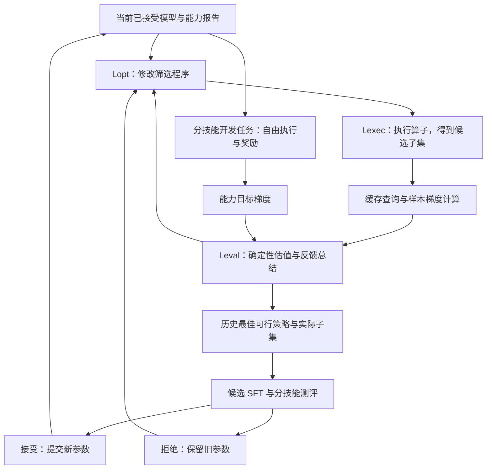

# Self-Curate：架构与 Codex 分阶段实施指南

> 版本：v0.1 · 2026-11-01  
> 用途：研究代码项目的执行说明；建议放在仓库 `docs/implementation_blueprint.md`。  
> 状态：架构已约定，梯度代理的有效性、搜索收益和自改进效果仍需实验验证。本文中的具体比例、阈值及命令配置是开发示例，不是实验结果。所有 CLI 命令除 Git/GitHub 命令外均是**待实现的接口约定**。

## 1. 项目名称与研究目标

推荐仓库名：**`self-curate`**。显示名称：**Self-Curate**。暂用描述：*Model-driven, feedback-guided data curation across learning stages.*

含义是模型随着自身训练状态的变化，持续修订为自己选择下一批训练数据的程序。名称暂未做论文重名、商标或全网唯一性检查，不应据此宣称首创。

备选名称：`adaptive-curator`（强调适应当前模型）、`curation-loop`（强调训练反馈闭环）。仓库名先稳定下来，论文标题可以晚些确定。

### 1.1 一句话架构

**内层冻结当前模型，由共享参数的三个角色修改、执行和评价筛选程序；外层只对内层选出的最佳实际子集做 SFT，通过分技能自由执行测评决定是否提交新参数。**

研究目标不只是动态更新样本分数，而是让模型根据自身能力和历史反馈，修改筛选程序的算子、参数、顺序、分支及配额。

### 1.2 MVP 的成功标准

先在一个小规模、可验证的 Coding 场景完成：

1. 给定轨迹池、技能标注和当前 checkpoint，执行结构化筛选程序。
2. 在固定 checkpoint 下，通过缓存复用样本梯度特征，比较多个候选策略。
3. 返回历史最佳的**策略与其已评价过的精确样本清单**。
4. 只训练一次候选模型，完成接受或拒绝流程。
5. 接受后进入新 checkpoint 命名空间；拒绝时保留旧状态和失败经验。
6. 能从日志复现策略选择、预算消耗、样本组成和模型状态变化。

MVP 跑通不等于论文创新得到验证。真实梯度代理校准和强基线对比是独立的研究关卡。

## 2. 架构中不能改变的约定

| 约定 | 工程含义 |
| --- | --- |
| 内层不更新权重 | 可以前向、反向；不能调用训练更新步骤 |
| 三角色共享权重 | Lopt、Lexec、Leval 引用同一个不可变 ModelRef，prompt、上下文与记忆分别维护 |
| Agent 使用工具 | LLM 负责提案、诊断和组织；算子、梯度、统计和验收由代码执行 |
| 先筛数据再算梯度 | 不能把全候选池默认做一遍反向再称为按需计算 |
| 同版本缓存复用 | checkpoint、adapter、模板、掩码、投影等身份必须一致 |
| 评价口径固定 | Lopt 不能修改奖励、质量门槛、验收阈值或 Leval 的聚合目标 |
| 内层无需候选 SFT | 不为每个候选程序训练模型；校准实验另外执行 |
| 最好方案不是最后方案 | 搜索结束返回历史最佳可行策略及对应批次 |
| 开发集承担双重用途 | 同一分技能开发集用于目标梯度与外层决策，不称为独立验收集 |
| 最终测试集隔离 | 不进入 Agent 上下文、目标梯度、搜索或接受决定 |
| 拒绝也保留历史 | 参数不提交；尝试、成本、失败反馈不能消失 |
| Coding / General 分离 | 使用不同数据、任务、技能配置与实验，不混合训练 |

“同一个模型”指同一参数身份，可以按资源需要部署为不同进程。不能悄悄用更强的外部模型替代控制角色，再将结果标成共享模型自筛选。

## 3. 模块边界与信息流



图中的内层循环受预算与停止条件约束，不能从每次 Leval 报告直接触发一次 SFT。每次外层尝试都会保存历史；接受和拒绝都把反馈传给下一次 Lopt。

### 3.1 三角色职责

| 角色 | 必须读取 | 可调用工具 | 输出 | 不能做什么 |
| --- | --- | --- | --- | --- |
| Lopt | 能力报告、候选池摘要、相关策略与实测历史 | 查询摘要、校验程序、提交新程序 | 完整程序、父版本、修改理由与假设 | 改 evaluator、绕过质量门槛、直接提交模型 |
| Lexec | 已校验程序、数据清单、ModelRef | 执行算子、查询缓存、计算缺失梯度 | BatchManifest、执行轨迹、缓存与成本报告 | 自行放宽条件、把未计算梯度伪装成零 |
| Leval | 批次、两侧梯度、固定目标配置 | 运行数值估值、查询历史、保存总结 | 数值报告及自然语言诊断 | 由 LLM 编造分数或改验收标准 |

Lexec 可以是一个非常薄的 LLM 工具控制层，但正式三角色配置仍保留其共享模型身份和独立记忆。消融中允许将其替换成确定性执行器，检验该角色是否提供额外价值。

### 3.2 两层 Leval

- **数值内核**：计算影响估计、配额、覆盖、成本和有效性，结果可复现。
- **解释角色**：读取结果，区分观测与假设，提出给 Lopt 的反馈。

LLM 的自然语言判断不能覆盖数值内核输出。接受规则同样放在代码中。

## 4. 建议的仓库结构

```text
self-curate/
  README.md
  AGENTS.md
  pyproject.toml
  docs/
    implementation_blueprint.md
    decisions.md
    progress.md
    experiments.md
  configs/
    demo.yaml
    toy.yaml
    coding_pilot.yaml
    programs/seed_program.json
  src/self_curate/
    contracts/          # 所有模块共用的 schema 与版本
    data/               # 导入、规范化、监督掩码、证据标签
    operators/          # 算子注册、校验、执行、预算组批
    signals/            # NLL、entropy 与参考组百分位
    gradients/          # 样本梯度、目标梯度、投影、版本缓存
    valuation/          # 数值估值与 EvaluationReport
    agents/             # 共享模型客户端、三个角色、提示词
    memory/             # 角色记忆与检索
    search/             # 内层搜索、历史最佳、停止与预算
    training/           # 候选 SFT 与训练产物
    evaluation/         # 自由执行任务、奖励与能力报告
    orchestration/      # 外层状态机、恢复、接受与拒绝
    storage/            # manifest、事件日志、成本账本
    cli.py
  tests/
    unit/
    integration/
    fixtures/
  scripts/
  .github/workflows/ci.yml
```

原始轨迹、模型、梯度文件、运行目录不提交到 Git。仓库可以包含少量合成 fixture 和脱敏小例子。

基础实现使用 Python 包和 CLI；先不引入数据库服务、Web UI、复杂 Agent 框架或分布式调度平台。MVP 用结构化文件、轻量索引和本地存储即可。实际训练/推理框架用 adapter 封装，避免绑定某一个供应商。

## 5. 核心数据契约：先定义，再写业务代码

所有契约应有 schema_version；所有大文件通过 artifact 引用，不塞入 Agent prompt。路径不是内容身份，重要产物同时保存内容 hash。

| 契约 | 必需字段与说明 |
| --- | --- |
| ModelRef | 基础权重身份、adapter 内容 hash、tokenizer、模板、参数表示；不能只用 accepted_03 这种显示名 |
| TrajectoryRecord | data_id、content_hash、messages、来源、监督 token、质量状态、技能证据、使用历史引用 |
| TaskRecord | task_id、技能组、环境版本、评分器版本、split、最大预算 |
| SignalRecord | 模型身份、样本身份、统计范围、NLL、entropy、CDF 版本、计算配置 |
| ProgramSpec | program_id、parent_id、schema_version、算子节点、输入依赖、输出节点、seed |
| BatchManifest | batch_id、program_hash、排序后的唯一 ID、样本内容 hash、分支归属、token、训练顺序或其 seed |
| GradientSpec | 参数坐标、loss 定义、mask、归一化、投影、精度、模型身份、可选优化器变换身份 |
| GradientFeature | data_id 或目标组 ID、完整 cache_key、向量 artifact、norm、有效性与计算成本 |
| RolloutRecord | 模型、任务、采样 seed/config、生成 token、工具上下文、奖励、完成状态、评分器身份 |
| EvaluationReport | batch_id、目标版本、各技能估值、固定总目标、约束、计算覆盖、成本、有效性 |
| CapabilityReport | 模型、任务版本、逐任务奖励、分技能汇总、样本数、不确定性、执行成本 |
| RoundRecord | 起始模型、目标配置、搜索结果、训练产物、实测结果、decision、理由、资源账本 |

### 5.1 数据使用状态必须分开记

至少区分：

- 是否做过前向评分；
- 是否做过梯度提取；
- 是否进入过候选 SFT；
- 是否进入过已接受模型的训练历史。

被拒绝的候选 SFT 仍然发生过，成本和训练暴露记录必须留下。第一版默认排除已经进入已接受模型训练历史的数据；对于只进入过被拒绝分支的数据，单独配置是否允许重试，并报告复用比例，不能自动当成从未使用。

### 5.2 统一错误类型

至少包含 `INVALID_PROGRAM`、`INSUFFICIENT_POOL`、`MISSING_SIGNAL`、`STALE_CACHE`、`ZERO_TARGET_GRADIENT`、`BUDGET_EXHAUSTED`、`ENVIRONMENT_FAILURE`、`INVALID_REWARD`。

错误要保留结构化原因，不能统一变成空批次或零分。任务真实失败可以按评分规则得到零奖励；基础设施异常不能悄悄记成模型失败。

## 6. 模块 M1：数据与标注

**输入**：已有轨迹、技能标注、执行验证证据。  
**输出**：规范化 TrajectoryRecord 和数据池清单。

要求：

1. 将 user、assistant、tool 角色与训练模板明确对应。
2. 默认仅监督 assistant 动作和回答；工具返回只作为上下文。
3. 质量检查分 pass / fail / unknown，并保留验证来源。
4. 技能证据保存可定位的消息和 token span；必须绑定 tokenizer/模板版本。
5. 轨迹长度定义不能含糊：assistant 回合数、工具调用数、输入 token 和监督 token 分开统计。
6. 不自动裁剪轨迹来凑预算；超长样本如何处理由显式配置决定。

证据指标定义：

- 技能证据占比 = 该技能证据与监督 mask 相交后的 token 数 / 全部技能证据与监督 mask 相交后的并集 token 数。
- 技能证据密度 = 该技能证据监督 token 数 / 全部 assistant 监督 token 数。
- 充分性 = 证据绝对 token 数、完整事件数、是否存在有效修正与后续验证等。

多技能证据可能重叠，因此技能占比之和可以超过 1。分母为零或未标注时标为 missing，不能伪装成 0。质量验证通过不能仅依赖 Teacher 判断。

**验收**：用一个有重叠技能证据、一个缺失证据、一个工具长输出的 fixture 检查分母、mask 和缺失处理。

## 7. 模块 M2：筛选算子与程序执行器

### 7.1 第一版算子

| 算子 | 作用 | 第一版参数 |
| --- | --- | --- |
| SkillSelect | 匹配技能或构造分支 | skills、any/all、missing_policy |
| EvidenceSelect | 检查目标技能证据充分性 | target_skill、min_share、min_density、min_tokens、min_events、required_behaviors、missing_policy |
| NLLSelect | 学习难度区间或截断 | scope、raw/percentile、interval、keep_fraction、rank_direction、reference_group |
| EntropySelect | 不确定性区间或截断 | scope、raw/percentile、interval、keep_fraction、rank_direction、reference_group |
| LengthSelect | 限制轨迹长度和成本 | assistant_turn_range、tool_call_range、supervised_token_range、context_token_range |
| DedupSelect | 去重与代表样本选择 | exact/annotated_group/semantic、threshold、representative_rule |
| SampleSelect | 可复现抽样 | uniform/ranked/stratified、size 或 token_target、seed、strata |
| MixAllocate | 多分支配比、合并与唯一归属 | branch_token_shares、overlap_rule、shortfall_policy、seed |

固定外壳：`QualityGate` 在前，`BudgetPack` 在后。Lopt 不能绕过它们。

### 7.2 执行语义

- 算子输入是样本 ID 集合和只读 feature store，输出 ID 集合与执行报告；不生成新数据，不改原轨迹。
- 第一版程序采用无环图：共享入口 → 有序分支链 → MixAllocate → BudgetPack；暂不允许任意循环或执行 Python 代码。
- 每个节点使用声明过的 schema；拒绝未知字段、未知 operator、环和不存在的依赖。
- 固定范围过滤通常可交换。top-fraction、抽样、贪心去重和合并才可能体现顺序差异；不要为了叙事制造假的顺序收益。
- 如果缺 NLL/entropy，可以显式触发按需前向；这项成本计入预算。不得对缺失值填零。
- 分技能 CDF 使用固定参考样本身份和当前模型分数；不能因改变当前分支样本而偷偷改变参考尺度。
- 分支比例按**分配的监督 token**计账。同一条多技能轨迹只能进入训练清单一次，并只归属一个分支；另外报告语义技能暴露。
- 使用完整轨迹时比例受离散长度影响，配置容差并报告残差。不能宣称精确 60/40 而隐瞒实际比例。
- 配额不可行时返回缺口；不得静默放宽质量条件。若允许配额回填，必须是固定且可审计的规则。
- BudgetPack 的优先级、同分 tie-break、超预算处理固定。返回的最终清单才是 Leval 真正评价的对象。

### 7.3 程序示例

以下是待实现 DSL 的示例，不是已存在的软件格式；所有节点字段都需要在 contracts 中正式定义。

```json
{
  "schema_version": "1",
  "program_id": "program_004",
  "parent_id": "program_003",
  "seed": 17,
  "nodes": [
    {"id": "a1", "op": "SkillSelect", "inputs": ["eligible_pool"], "params": {"skills": ["failure_recovery"], "match": "any"}},
    {"id": "a2", "op": "EvidenceSelect", "inputs": ["a1"], "params": {"target_skill": "failure_recovery", "min_share": 0.5}},
    {"id": "a3", "op": "NLLSelect", "inputs": ["a2"], "params": {"scale": "percentile", "interval": [0.3, 0.8], "reference_group": "coding_bugfix"}},
    {"id": "b1", "op": "SkillSelect", "inputs": ["eligible_pool"], "params": {"skills": ["regression_check"], "match": "any"}},
    {"id": "b2", "op": "EvidenceSelect", "inputs": ["b1"], "params": {"target_skill": "regression_check", "required_behaviors": ["test_after_final_edit"]}},
    {"id": "mix", "op": "MixAllocate", "inputs": ["a3", "b2"], "params": {"branch_token_shares": {"a3": 0.6, "b2": 0.4}, "overlap_rule": "fixed_priority", "shortfall_policy": "report_infeasible"}}
  ],
  "output": "mix"
}
```

QualityGate、固定总预算、最终去重与 BudgetPack 来自系统配置，不在 Lopt 可修改区域。程序 hash 还需关联这份系统配置。

**验收**：相同输入/seed 结果相同；重叠样本只计一次；条件不足显式报错；固定过滤换序结果相同；具有截断操作的换序可以改变结果。

## 8. 模块 M3：模型服务与共享参数身份

对外拆成三种能力接口，但它们可以指向同一个已接受模型：

1. `generate_role`：根据角色 prompt 与独立记忆生成结构化提案或总结。
2. `rollout_tasks`：执行任务、调用工具，保存自由生成轨迹。
3. `score_and_differentiate`：在指定参考历史上计算分数与梯度。

冻结内层参数不等于关闭 autograd。梯度提取进程仍需对选定参数求导，但禁止 optimizer.step；纯推理服务不能冒充梯度后端。

每轮将三角色实际使用的 ModelRef 写入日志；若使用远端 endpoint，也要验证服务加载的权重版本。共享参数不要求共享 KV cache、对话上下文或记忆。

目标模型名、模型路径、GPU 数和 adapter 配置必须由配置传入，不把未经核验的模型型号写死。先在小模型验证，再扩大规模。

## 9. 模块 M4：分技能自由执行与能力目标梯度

### 9.1 能力报告

给定当前 ModelRef，在按技能分组的开发任务上自由执行，保存 RolloutRecord。每组至少保留逐任务奖励、重复采样配置、工具轨迹和执行成本，不能只保留成功率摘要。

同一套开发任务也用于外层比较。它是优化过程的一部分；最终测试集另存，默认不向搜索进程挂载。

### 9.2 第一版目标梯度

采用明确标为 **NICE-inspired 的单 checkpoint 适配**，不要将它标成完全复现 NICE。以固定任务组 k 的期望奖励 J_k 为目标：

```text
g_target[k] ≈ average over tasks and rollouts of
              advantage * grad(log probability of generated assistant actions)
```

实现前确定：任务权重、奖励尺度、采样次数、baseline/advantage、生成 token mask、工具环境上下文与聚合规则。任务平均与 rollout 平均不能混淆。

推荐先实现易校验的无 baseline REINFORCE，再加入独立或 leave-one-out baseline 降方差。不能在每任务只有一个 rollout 时直接减去该任务自身奖励，导致所有 advantage 为零。

工具输出作为固定环境观察，不对环境求导；只对模型生成动作/回答的 log probability 求导。不要默认沿用 SFT 的每 token 平均作为奖励梯度的定义。

若奖励恒定、过于稀疏或目标梯度 norm 接近零，返回有效性告警。可以在预先规定预算内补采样；不能把“未得到有效目标”解释为“所有数据价值为零”。超预算仍无有效目标时，结束该路径并报告，或采用预先声明的非梯度 baseline。

### 9.3 回放要求

保存 token ID、assistant 生成位置、动作与上下文、奖励、模型与采样版本，确保能在同一模型上 teacher-forced 重算 log probability。不要把工具结果或 user prompt 算进模型策略动作概率。

**验收**：在可枚举的简单随机策略上，Monte Carlo 目标梯度方向应与解析期望奖励梯度一致；真实模型小样本验证生成位置和掩码。

## 10. 模块 M5：样本梯度、压缩与缓存

### 10.1 样本侧

Lexec 先产生 BatchManifest，再查询缓存，只对未命中的样本计算 SFT 梯度。默认每条轨迹 loss 是 assistant 监督 token 的平均 NLL，保存监督 token 数。

按全批次监督 token 平均的 SFT 目标聚合时：

```text
g_batch = sum(n_x * g_x) / sum(n_x)
```

这里 g_x 是每样本 token 平均 loss 梯度，n_x 是其监督 token 数。如果真实 trainer 按序列等权、打包或梯度累积采取不同权重，代理聚合也要匹配并写入身份，不能只改公式不改训练。

**必须保留可重组的样本级特征**。只缓存整个批次总梯度不能支持任意新子集。微批次反向得到的平均梯度不等于每个样本各自的梯度。

### 10.2 两侧坐标一致

目标侧和样本侧必须使用相同参数坐标和投影映射。第一版可使用固定 LoRA 参数坐标，投影策略可插拔；先小维度精确实现，再做可扩展的流式随机投影。

LoRA 的初始化、rank、缩放和 A/B 坐标必须固定并记录。零初始化的一侧可能使部分坐标初始梯度为零，要检查实际有效梯度，不能将参数化退化误认为数据无价值。第一版建议持续训练同一 adapter 参数化；重新初始化或 merge/re-attach 属于明确版本变化。

先实现原始梯度与一阶 SGD 代理，完成方向校验。若外层使用 Adam 类更新，则添加独立、版本化的 optimizer-aware 变换，并验证对真实增益预测的影响。未实现时明确称为近似代理，不宣称等价于实际优化器或完整 NICE。

### 10.3 缓存身份

cache_key 至少包含：模型权重/adapter hash、数据内容 hash、tokenizer 与模板、监督 mask、截断规则、loss reduction、参数坐标、梯度变换、投影 seed/维度、精度策略、实现版本；依赖优化器状态时还包括该状态身份。

目标梯度再绑定开发任务、rollout、奖励/advantage 和目标聚合版本。

- 同 checkpoint、同配置的重叠样本可直接复用。
- 接受新模型后建立新命名空间，禁止把旧梯度当作新梯度。
- 拒绝模型不变，旧有效缓存仍可使用。
- 影响分数还绑定 target_version；目标改变后可以复用样本特征重算分数，不能复用旧分数冒充新分数。
- NLL/entropy 可在兼容的梯度前向中顺便采集；只需分数时不必反向。

固定 dropout 行为，记录随机配置；梯度任务进入与生产设置一致且可重现的模式。每次计算前清理梯度，避免污染；纯评分结束检查模型参数和训练状态未被更新。

缓存写入采用临时文件加原子提交、校验与完成标记；中途退出产生的半成品不能算命中。

**验收**：A 选100条、B选120条、重叠80条时只新增40条梯度；变更 checkpoint 或 mask 必须失效；真实梯度前后参数 hash 一致。

## 11. 模块 M6：Leval 数值估值

### 11.1 一个方向清楚的最小实现

若 g_target[k] 是奖励 J_k 的**上升**方向，g_batch 是 SFT loss 的梯度，SGD 更新为 θ' = θ − ηg_batch，则：

```text
predicted_gain[k] ≈ -η * dot(g_target[k], g_batch)
```

必须把正负号写进测试。如果目标侧实际实现的是负奖励 loss 梯度，符号随定义改变，不能照抄公式。用小型可解析模型或有限差分验证方向。

归一化 cosine 可以作为另一个 estimator，但它与内积不等价，不能混用名字。投影是近似，需要与小规模精确内积比较误差。

### 11.2 批次评价

固定评价配置包括：目标技能权重、保持技能约束、固定预算、容差、代理形式与有效性要求。第一版可以使用固定加权 predicted_gain 总目标，质量与预算作为硬约束；覆盖/重复先作为诊断及程序约束，避免随意叠加一堆未经校准的奖励项。

报告必须包含：各技能估值、总估值、已计算比例、norm/异常、监督 token、实际配比、来源覆盖、重复、与 best-so-far 的差异、新增计算成本。

无效目标或梯度不完整的批次，不得参与“最佳可行方案”比较。噪声较大时使用预先设定的最小改善或重复估计规则，不能把语言解释当成显著性证据。

### 11.3 为什么先做校准

梯度分数是一阶局部代理，不自动覆盖样本互补、冗余、多步 SFT 与长轨迹误差。真实搜索开始前，抽取高分、中分、低分和随机子集，在相同起点/训练预算下做小规模训练，检验预测与实际分技能增益的关系。

校准失败时，优先检查符号、掩码、权重、奖励、参数坐标、训练预算和方差。不要立刻扩大多 Agent 搜索来掩盖代理失效。

## 12. 模块 M7：角色提示词、记忆与内层搜索

### 12.1 共享模型客户端

`RoleAgent` 由共享 ModelRef、独立 role prompt、工具白名单和 memory namespace 组成。三个角色使用同一参数身份，不训练三套独立控制模型。

记忆建议分为 append-only 事实记录和可重建的摘要索引。Lopt 记策略假设与效果；Lexec 记执行可行性、分布和成本；Leval 记估值、实测与预测偏差。所有历史保留适用 checkpoint 和条件，不能把旧模型下失败泛化成永久有害。

### 12.2 Lopt 输出协议

每轮输出完整 ProgramSpec 加修改摘要：父程序、改变节点、预期影响、引用报告 ID。第一版由代码 diff 计算实际变更，不执行 LLM 生成的任意脚本。校验失败可反馈结构化错误并有限重试，重试消耗计入成本。

### 12.3 搜索状态

维护 current、best_feasible、search_history、stagnation_count、budget_ledger。候选可以串行产生和比较，**不要求同时训练或同时评价大量策略**；后续可加批量提案，但需要独立预算与公平对比。

第一版流程：固定 seed 程序 → Lopt 提案 → 校验 → Lexec 执行 → 缺失梯度补算 → Leval 估值 → 保存报告 → 更新 best → 决定继续或停止。

停止条件取先满足者：最大候选数、连续未改善次数、唯一新增梯度 token 预算、Agent token 预算、时间预算。计入无效提案成本，防止无限修复循环。

返回的 SearchResult 固定引用 best 的 BatchManifest、程序 hash、评价报告与信号版本；后续训练不能重新随机抽一批。

**验收**：模拟报告先升后降时返回最高值的历史批次；预算中断仍能返回已完成的最佳可行项；无可行项时显式失败。

## 13. 模块 M8：外层候选 SFT、任务测评与提交

### 13.1 SFT

从已接受 ModelRef 创建隔离候选，按同一固定 recipe 训练选定批次。模型路径、LoRA、loss reduction、训练监督 token、学习率、优化器和 seed 全部落盘。

数据选择预算与训练预算分开：选了多少独特轨迹、实际优化处理多少监督 token、重复 epoch 多少，都要报告。不同子集长度变化不能导致某方法悄悄多训练。

训练前后 NLL 是拟合诊断；不把 entropy 下降或训练 loss 下降作为模型验收证据。

### 13.2 自由执行评价

在同一分技能开发任务上比较候选和当前模型，保存逐任务配对结果。可以复用已存在且配置一致的旧模型基线记录；不能把不同采样/评分器版本的结果直接比较。

接受规则由实验配置预先定义，例如目标收益、保持技能退化上限、执行成本限制和最少有效任务数。具体阈值在 pilot 前确定，本文不代填。

区分 accept / reject / needs_more_evidence；证据不足时在预定预算内复测，仍不足则拒绝提交并记录原因，不由 Agent 临时放宽规则。重复生成不是独立任务样本，不确定性估计应保留任务聚类结构。

### 13.3 原子提交

- accept：训练产物与测评产物完整后，原子更新 accepted_model 指针，更新已接受训练历史，切换三角色版本，建立新目标梯度和缓存空间。
- reject：accepted_model、其优化器状态和随机状态不变；候选训练产物作为尝试记录保存，不污染正式状态。
- 无论结果：保存预测/实测差异、策略、样本清单、决定原因、成本及角色记忆。

提交后若复用候选模型测评 rollout 计算新目标梯度，必须确认参数、token、模板、采样和奖励配置完全兼容。

拒绝后禁止无限重复相同组合；保留 batch hash 与条件化 defer 记录，并受外层尝试总预算约束。

## 14. 模块 M9：状态机、恢复与成本账本

### 14.1 状态机

```text
ROUND_CREATED
→ TARGET_READY
→ SEARCHING
→ BEST_SELECTED
→ CANDIDATE_TRAINED
→ CANDIDATE_EVALUATED
→ COMMITTED 或 REJECTED
→ FEEDBACK_SAVED
```

每个转换检查前置 artifact 完整性。新阶段完成才写完成事件；重启从最近完整阶段继续。训练任务启动后崩溃，先检查已有 checkpoint 和任务标识，不能直接重复扣预算并重训。

外层用 `attempt_id` 区分尝试，用 `accepted_version` 区分晋级次数；拒绝会增加 attempt_id，不增加 accepted_version。

### 14.2 成本必须分项

记录 Agent 输入/输出 token、前向评分 token、唯一新增梯度样本与 token、缓存命中、开发任务生成与工具成本、SFT 监督 token、GPU 时间、墙钟时间、失败与复测成本。

不要只报候选数，也不要把缓存命中视为零 I/O 成本。论文比较同时提供固定训练预算结果与总资源成本；训练量相等不代表总成本相等。

## 15. 三个算法对应到代码

### Algorithm 1：外层交替过程 — orchestration/outer_loop.py

```text
load accepted model, pool, development tasks, history
for each outer attempt within total budget:
    ensure current capability report and target gradients are valid
    result = inner_search(frozen_model, targets, history)
    if no feasible result: record failure and stop under configured policy
    feedback = train_evaluate_and_decide(accepted_model, result.exact_batch)
    save feedback and role memories
    if accepted: switch ModelRef; create new signal/cache namespace
evaluate final selected model on held-out final test only for reporting
```

### Algorithm 2：内层搜索 — search/inner_loop.py

```text
freeze ModelRef and fixed evaluation config
while search budget remains and stagnation limit not reached:
    program = Lopt.propose(context)
    validate program
    batch, execution = Lexec.execute(program)
    features = cache.fetch_or_compute_missing(batch, ModelRef, GradientSpec)
    report = valuation.evaluate(batch, features, fixed_targets)
    summary = Leval.summarize(report, related_history)
    persist all artifacts and update best feasible result
return historical best program + exact evaluated manifest + report
```

### Algorithm 3：候选学习与决策 — orchestration/outer_step.py

```text
train candidate from accepted model using exact selected manifest
run fit diagnostics and free-execution development evaluation
decision = fixed_acceptance_rule(paired_results)
if accepted: atomically commit candidate
else: keep accepted state intact
record actual gain, proxy error, costs, exposure history, decision
return decision and feedback
```

## 16. Vibe coding 实施顺序：每个阶段是一个可交付任务

不要让 Codex 一次生成整个系统。每阶段先读相关契约，完成代码、必要验证、运行命令和 progress 记录，再进入依赖它的下一阶段。

### P0 — 冻结接口与工程骨架

**范围**：建立目录、pyproject、contracts、配置校验、文档和 AGENTS.md；整理待决策项。不接 GPU、不下载数据或大模型。  
**产物**：核心 schema、最小合成 fixture、CLI help、decisions.md。  
**验收**：合法配置可加载；缺关键字段明确失败；所有 ModelRef 和 artifact 可序列化。  
**下一步条件**：程序、批次、梯度、报告和 round 的接口一致。

### P1 — 算子执行与可复现组批

**范围**：M1/M2，先使用已有 fixture 分数。  
**产物**：八个算子、固定外壳、执行 trace、BatchManifest。  
**验收**：预算、重叠、缺失值、顺序、seed、不可行报告符合第7节。  
**下一步条件**：给同一程序能得到同一精确清单。

### P2 — 无 GPU 的完整模拟闭环

**范围**：search、outer state machine、storage、模拟模型/梯度/训练/测评后端。Agent 先用 scripted proposer。  
**产物**：两次外层尝试，一个接受、一个拒绝，支持 resume。  
**验收**：返回历史最佳而非最后候选；接受切版本；拒绝不变参数；重启不重复提交。  
**限制**：所有模拟产物标 `backend=mock`，不得进入真实实验表。

### P3 — 小模型真实分数和样本梯度

**范围**：接真实 scoring/gradient backend、监督 mask、样本级梯度、投影与缓存。  
**产物**：小模型下可复现的 NLL/entropy/梯度 artifact。  
**验收**：参数不变；批次聚合对齐；精确与投影内积对照；重叠只计算新增样本；旧版本缓存失效。

### P4 — 自由执行目标梯度与代理校准

**范围**：M4/M6，先用低成本可验证环境，再接小规模 Coding。  
**产物**：目标梯度、分技能估值、预测/实测校准报告。  
**验收**：解析/有限差分方向正确；奖励与 mask 可追溯；至少完成高/中/低/随机子集的受控实际训练对照。  
**研究关卡**：若代理完全不能预测实际收益，暂缓扩大搜索，记录问题并修正估值设计；不伪造相关性。

### P5 — 接入共享模型三角色

**范围**：共享 ModelRef、独立 prompt/记忆、受 schema 约束的提案与总结、工具白名单。  
**产物**：完整内层真实搜索与变更历史。  
**验收**：三角色权重身份一致；LLM 无法改 evaluator；无效 JSON 有限重试；调用与工具成本齐全。  
**顺序理由**：先知道确定性系统正确，再观察模型是否会提出有效策略。

### P6 — 小规模真实外层闭环

**范围**：真实 LoRA SFT、开发任务评价、接受/拒绝、目标信号刷新与恢复。  
**产物**：至少验证一条接受路径和一条拒绝路径；可用受控测试验证分支，但真实结果保持原样。  
**验收**：训练精确使用 best manifest；提交原子；拒绝不污染；新模型使用新信号身份；所有成本可核对。

### P7 — 论文实验与规模扩大

**范围**：锁定配方后扩大模型、数据和任务；加入同预算 baseline 与消融。  
**主基线**：随机、静态分数规则、动态重评分但固定规则、同约束直接梯度排序/优化、参数可变但结构固定、完整程序搜索。  
**关键验证**：梯度代理可靠性；程序修改是否优于仅更新分数；逐步反馈是否优于固定 curriculum；更新后的模型是否更会选择数据；缓存和搜索是否值得成本。  
**验收**：最终测试隔离、多 seed/任务层面不确定性、失败案例、总资源账本与可复现实验清单。

在 P4 之前不要投入大规模 benchmark，在 P6 之前不要把“共享模型自改进”写成已经验证的结果。

## 17. 每个阶段交给 Codex 的标准任务单

将下面内容复制进任务描述，替换阶段和范围：

```text
你正在实现 Self-Curate 研究项目。
先阅读 AGENTS.md、docs/implementation_blueprint.md、docs/decisions.md 和 docs/progress.md。
本次只完成阶段 Px：[阶段名称]。

目标：[本阶段可观察结果]
输入：[已有文件、schema、fixture]
范围：[允许实现的模块]
暂不实现：[后续依赖或昂贵功能]
验收：[本阶段的可执行检查]

实施前检查当前代码与接口，不假设规划中的模块已经存在。
优先复用现有结构；需要变更公共契约时同步调用方、测试和决策记录。
不要以 mock 输出替代要求的真实算法；mock 必须明确标注。
遇到未确定的研究语义，先查本说明和决策记录；常规工程细节自行选择并记录。
若缺失信息会改变奖励、梯度定义、数据隔离或模型提交语义，则保留显式阻塞项，
继续完成不依赖它的模块，不擅自填造研究设定。

完成后运行与本阶段相关的检查，修复失败；更新 docs/progress.md。
报告：已实现行为、修改文件、验证结果、仍未解决的问题和下一阶段输入。
不得声称通过未运行的 GPU 测试或未完成的真实实验。
```

### 17.1 推荐的第一次任务

```text
请依据 docs/implementation_blueprint.md 完成 P0。
先生成根目录 AGENTS.md，再建立 Python 包骨架和核心 contracts。
提供一个小型合成 coding 轨迹 fixture，以及能够加载并校验配置的 CLI。
将研究未定项集中记录在 docs/decisions.md，区分已决策、建议默认和待实验确认。
只做 P0；不要开始训练、下载大模型或接入真实 benchmark。
运行 schema/CLI 的必要检查，并在 docs/progress.md 写明 P0 验收结果。
```

### 17.2 后续短指令

```text
继续完成 P1。以已验收的 P0 契约为基础，实现八个算子与固定质量/预算外壳。
重点检查多技能样本去重计账、比例残差、缺失值和可复现性。
```

```text
继续完成 P2。用明确标识的 mock 后端跑通两个外层尝试和断点恢复。
此阶段不接 GPU，重点验证历史最佳、接受提交与拒绝保留旧状态。
```

其余阶段使用第17节任务单填入第16节范围。不要一次把 P3 到 P7 全部交给一个无边界任务。

## 18. 可放入根目录的 AGENTS.md 初稿

下列是**建议写入的项目指令**，不会仅因出现在本文中就自动成为仓库文件。

```markdown
# Project instructions

## Goal
Implement Self-Curate according to docs/implementation_blueprint.md.
Read docs/decisions.md and docs/progress.md before changing behavior.

## Architecture invariants
- Freeze model weights within inner search; gradient extraction must not update parameters.
- Lopt/Lexec/Leval share the same accepted ModelRef, with separate prompts and memories.
- Execute filtering, scoring and acceptance through deterministic code.
- Select a candidate subset before computing missing sample gradients.
- Reuse gradients only under an identical cache identity.
- Train the exact historically best evaluated manifest, not a resampled replacement.
- Never let the proposer modify quality gates, rewards or acceptance rules.
- Preserve failed attempts, costs and evidence after rejection.
- Keep the final test split outside optimization and Agent context.

## Implementation
- Implement one requested milestone at a time with explicit contracts.
- Keep pure operator logic separate from model/GPU backends.
- Use explicit configuration; no hard-coded model paths or machine-specific assumptions.
- Label mock artifacts. Never fall back from real execution to mock silently.
- Keep immutable manifests and content-based identities for important artifacts.
- Add targeted checks for mathematical signs, masks, cache invalidation and state transitions.
- Do not commit datasets, model weights, gradient stores, credentials or large run outputs.
- Update decisions and progress when interfaces or milestone status change.

## Reporting
Report observable behavior, relevant checks, limitations and next required inputs.
Do not fabricate metrics, unrun tests or research conclusions.
```

## 19. 待确定配置：实现前按阶段填写

| 项目 | 最晚确定阶段 | 当前建议 |
| --- | --- | --- |
| 实际模型路径、tokenizer、GPU/显存 | P3 | 先小模型，规模由资源实测决定 |
| 技能体系、证据标准、数据权限 | P1/P4 | Coding pilot 先少数可验证技能 |
| 奖励函数、任务集版本、自由执行 harness | P4 | 可执行测试优先；来源与失败类型可追溯 |
| rollout 次数与方差处理 | P4 | 从小预算 pilot 决定，不先固定大数值 |
| 梯度坐标、投影维度、优化器变换 | P3/P4 | 先精确小模型，再压缩，再校准 |
| batch token 预算与 SFT reduction | P3/P6 | 与实际 trainer 对齐 |
| 目标权重、保持约束和接受阈值 | P4/P6 | 单独配置、提前固定，Lopt 无权限修改 |
| 搜索与总训练资源上限 | P2/P6 | 所有路径，包括失败与复测都计账 |
| 使用过但被拒绝的数据重试规则 | P1/P6 | 与已接受训练历史分开处理 |
| 最终测试集与实验种子 | P7 前 | 测试集在搜索阶段不暴露 |

## 20. GitHub 建仓与本地开发：推荐操作

**建议现在就建一个私有仓库，再 clone 到你实际让 Codex 修改代码的机器上。** 不需要等论文名字确定。GitHub 存放版本历史，本地目录是工作副本；GPU 服务器可以再 clone 一份，不要复制混乱的 zip 版本。

### 20.1 路线 A：网页建仓，最容易理解

1. 登录 GitHub，打开 <https://github.com/new>。
2. Repository name 填 `self-curate`。
3. 初期选 Private；Description 可填 `Model-driven adaptive data curation with feedback-guided training`。
4. 勾选添加 README；选择 Python .gitignore。许可证可以等明确开源计划后再确定。
5. 创建仓库，复制页面 Code 菜单中的 HTTPS 地址。
6. 在电脑或开发服务器终端，进入希望存项目的父目录，运行下面命令。将 YOUR_GITHUB_NAME 替换成你自己的用户名：

```bash
git --version
git clone https://github.com/YOUR_GITHUB_NAME/self-curate.git
cd self-curate
git status
git switch -c setup/blueprint
mkdir -p docs
```

私有仓库需要身份验证。按 GitHub 提示使用凭据管理器、GitHub CLI 或已有 SSH 配置；不要将 token 写进远程 URL 或文档。

下载本 Markdown，将它复制并重命名为仓库中的 `docs/implementation_blueprint.md`。随后：

```bash
git add docs/implementation_blueprint.md
git diff --cached --stat
git commit -m "docs: add architecture and implementation blueprint"
git push -u origin setup/blueprint
```

在 GitHub 上将该分支合入主分支，然后回到主分支并开始 P0。如果本地默认主分支叫 main：

```bash
git switch main
git pull --ff-only
git switch -c feat/p0-contracts
```

如果首次提交提示作者身份未配置，在仓库内设置自己的提交姓名和邮箱即可：

```bash
git config user.name "YOUR_NAME"
git config user.email "YOUR_COMMIT_EMAIL"
```

### 20.2 路线 B：已有 GitHub CLI 时一条命令建仓并 clone

此路线与路线 A 二选一，不要创建两次同名仓库：

```bash
gh auth login
gh repo create self-curate --private --add-readme --gitignore Python --clone
cd self-curate
git switch -c setup/blueprint
mkdir -p docs
```

再把本文放入 docs，按前面的 add/commit/push 流程提交。

### 20.3 每个阶段的日常工作方式

1. 从更新后的 main 开一个阶段分支，例如 `feat/p1-operators`。
2. 让 Codex 读取项目说明，只完成该阶段。
3. 检查运行结果与 `git diff`；提交代码、配置、必要测试和进度文档。
4. 阶段验收通过后合入 main，再做下一阶段。

GPU 服务器以同一仓库和 commit 为起点执行实验。代码版本与实验输出通过 run manifest 关联；大模型、数据和梯度保存在仓库外的配置路径中。

不要在尚未提交的工作上直接 pull。多台机器各自修改时用分支和提交同步，避免同名文件覆盖。

### 20.4 .gitignore 建议追加

```gitignore
# local configuration and credentials
.env
.env.*
!.env.example
configs/local/

# generated research artifacts
data/
models/
checkpoints/
gradient_cache/
runs/
artifacts/
wandb/

# Python runtime
__pycache__/
*.py[cod]
.venv/
.pytest_cache/
```

这些规则针对运行产物；小型合成 fixture 放在 `tests/fixtures/`。建议在首次大量导入前写好忽略规则，避免先提交再清理。

## 21. 开发完成的最终定义

不是“生成了八个算子、三个 Agent 类和一个循环”，而是：

- 任一接受模型都可追溯到精确数据、策略、训练配方和能力证据。
- 任一估值都能找到对应的两侧梯度、checkpoint、奖励与聚合定义。
- 任一拒绝都不会改变正式参数，但会留下可检索的失败经验。
- 同一输入可以重放筛选与比较，所有新增资源有账可查。
- 真实实验与模拟运行完全区分，最终测试不参与优化。
- 在同预算的直接梯度筛选和动态固定规则面前，能清楚判断程序修改到底贡献了什么。

## 22. 官方参考与实现边界

- NICE，ICML 2025：<https://proceedings.mlr.press/v267/wang25bm.html>；代码：<https://github.com/JTWang2000/NICE>。本文是基于其思想的单 checkpoint 适配设计，完整复现需另外对照原文及代码。
- GitHub 新仓库：<https://docs.github.com/en/repositories/creating-and-managing-repositories/creating-a-new-repository>。
- GitHub clone：<https://docs.github.com/en/repositories/creating-and-managing-repositories/cloning-a-repository>。
- GitHub CLI repo create：<https://cli.github.com/manual/gh_repo_create>。
- LoRA 实现参考：<https://huggingface.co/docs/peft/main/package_reference/lora>。实际依赖版本由 P3 环境验证后锁定，不在本文声称兼容未测试的版本。

这份文档是实施蓝图，不是已经完成的软件。后续以代码、契约、决策记录和阶段验收共同维护架构，避免文档与实现长期分叉。
